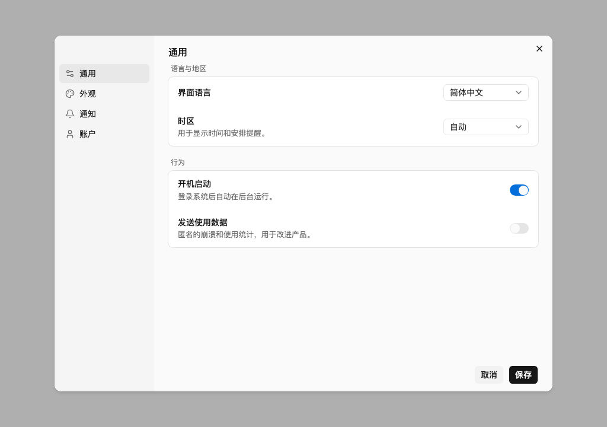
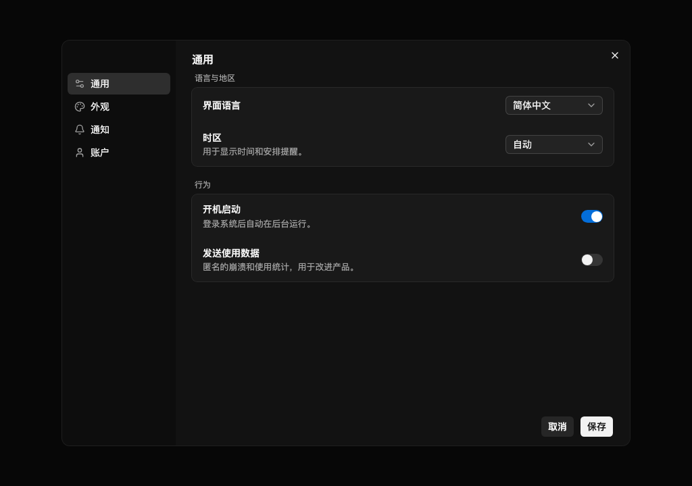

# marchen-design

English | [简体中文](README.zh-CN.md)

A black-and-white design system with a single accent color, built for tools and app interfaces (settings, lists, dialog forms, dashboards). Based on [shadcn/ui](https://ui.shadcn.com) (Base UI) and Tailwind CSS 4, installed with the official shadcn CLI.

- Black and white for primary actions; the accent color only marks state (switches, selection, focus). Everything else is pure neutral gray.
- In dark mode, surfaces get lighter as they rise; overlays use hairline borders instead of shadows.
- Radius and color are all derived from tokens — change one variable to adjust the whole system. The accent color is switchable.
- System fonts, compact density, default arrow cursor.

| Light | Dark |
| --- | --- |
|  |  |

Docs: <https://design.suemor.com>

## Installation

### New project

```bash
npx shadcn@latest init https://design.suemor.com/r/base.json
```

This writes the project config (including the `@marchen-design` namespace), the light and dark tokens and global styles, and installs the core components: button, input, textarea, field, select, switch, checkbox, dialog, dropdown-menu, popover, tooltip, toast, tabs, card, scroll-area (plus their dependencies label and separator).

### Existing project

Add the namespace to `components.json`:

```json
{
  "registries": {
    "@marchen-design": "https://design.suemor.com/r/{name}.json"
  }
}
```

Then install what you need:

```bash
npx shadcn@latest add @marchen-design/button @marchen-design/dialog
```

You can also install by URL without configuring the namespace: `npx shadcn@latest add https://design.suemor.com/r/button.json`.

> Installing `@marchen-design/base` overwrites the project's existing CSS variables and component config. If your project already has its own design system, install only the components you need.

### Blocks

Larger, ready-made structures built from the components. Not included in `base`; install on demand:

```bash
npx shadcn@latest add @marchen-design/settings      # SettingsDialog / SettingsShell / SettingsSection / SettingsRow
npx shadcn@latest add @marchen-design/sidebar-nav   # sidebar navigation list
```

### Accent color

Blue by default. Also available: `green`, `orange`, `pink`, `red`, `purple`:

```bash
npx shadcn@latest add @marchen-design/accent-green
```

Only the accent-related variables are overwritten; all other tokens stay the same.

### Tokens only

For projects that can't use the components (e.g. Radix or React Aria based shadcn projects), or if you just want the colors:

```bash
npx shadcn@latest add https://design.suemor.com/r/theme.json
```

Only CSS variables are updated — no components are installed and the project config is left untouched.

### Toast

Mount `<Toaster />` once at the app root, then call from anywhere:

```tsx
import { toast } from "@/components/ui/toast"

toast.add({ title: "Saved", type: "success" })
```

## Claude Code plugin

Makes Claude Code follow this design system when building UI. Install once per machine:

```
/plugin marketplace add marchen-dev/marchen-design
/plugin install marchen-design@marchen-design
```

| Entry | Usage |
| --- | --- |
| `/marchen-design:design-init` | Set up the current directory: creates a new project, or for an existing one installs `base` or only the tokens (Radix / React Aria projects). Always asks before overwriting anything |
| `design` (automatic) | Once the project's `components.json` has `@marchen-design`, just describe what you want ("build a settings page", "build a list page with search and filters"). It picks the right components and blocks, composes them by the rules, and runs the design lint when done |
| `/marchen-design:design-review` | Reviews changed UI files: lint script plus a checklist, reporting issues as "must fix" / "suggested". Never edits code on its own |

## Development

Requires Node 22.18+ and pnpm 10.

```bash
pnpm install
pnpm dev          # preview site: every component as a light/dark × accent matrix
pnpm gen          # regenerate after changing tokens/ or adding components
pnpm check        # generated-file consistency, dependency checks, design lint, types, eslint, unit tests, registry build
pnpm smoke        # run the real init / add flow in a temp directory
pnpm screenshot   # visual regression
```

Development conventions (sources vs generated files, adding a component, component visual spec) are in [AGENTS.md](AGENTS.md) (Chinese).

## License

[MIT](LICENSE)
